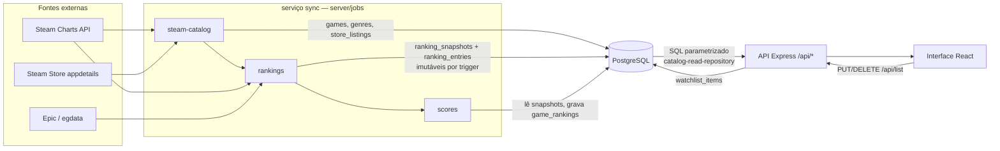

# SteamTwo: melhorias, back-end e documentação

Catálogo de jogos com dashboard de popularidade da **Steam** e da **Epic Games**. A interface é em React (Vite), a API em Node.js/Express e a persistência em **PostgreSQL 17**. Os dados são **reais**, coletados das APIs públicas das lojas.

- **Integrante:** João Hideki Takayasu
- **Disciplina:** Tópicos Especiais em Informática (Fatec), Prof. David Silva
- **Projeto-base:** [DavidSilvaProg/steamtwo](https://github.com/DavidSilvaProg/steamtwo). O primeiro commit deste repositório é o projeto-base intacto; os commits seguintes são as alterações deste trabalho.

---

## Executar (um comando)

Requisito: Docker com Docker Compose.

```bash
docker compose up --build
```

Abra **http://localhost:3001**. O comando sobe quatro serviços, em ordem:

| Serviço | O que faz |
|---|---|
| `postgres` | PostgreSQL 17 com volume persistente (`steamtwo_pgdata`). |
| `migrate` | Roda `node-pg-migrate up` (migrações 001 e 002) e o **seed** idempotente (10 jogos). Termina com sucesso e libera os demais. |
| `api` | API + interface compilada na porta 3001. Healthcheck em `/api/health`. |
| `sync` | Coleta **real**: descobre jogos do top da Steam, grava snapshots Steam/Epic e recalcula o Índice SteamTwo. Roda ao subir e a cada `SYNC_INTERVAL_MINUTES` (padrão 30). |

O primeiro ciclo do `sync` leva cerca de 1 minuto (busca detalhes e verifica as capas de ~40 jogos na loja Steam). Até ele terminar, o catálogo mostra só os 10 jogos do seed e o dashboard avisa que ainda não há rankings calculados (eles surgem quando o job `scores` termina).

Para conferir rapidamente:

```bash
curl http://localhost:3001/api/health    # {"status":"ok","mode":"database","database":{"status":"connected"}}
curl http://localhost:3001/api/status    # contagens no banco, frescor das fontes e últimos jobs (tabela sync_runs)
docker compose logs sync                 # saída de cada etapa da coleta
```

Na interface, o selo **PostgreSQL** no cabeçalho e a página **Status da integração** (rodapé, ou `/status`) mostram de onde vêm os dados.

### Verificar (testes)

```bash
docker compose --profile test run --rm --build test   # sem Node local: unitários + API + integração PostgreSQL + Sites
# ou, com Node 20+ e o banco do compose no ar:
npm ci && cp .env.example .env && npm run verify      # npm test + build + test:sites
```

Resultado esperado: **59 testes** Vitest (8 arquivos, sendo 15 de integração com PostgreSQL real, incluindo concorrência) e **4** testes `node:test` de Sites, todos passando. Sem banco configurado, a suíte de integração é pulada **com aviso**; no CI (`REQUIRE_DB_TESTS=1`), pular é falha. O GitHub Actions (`.github/workflows/ci.yml`) roda os testes e também sobe o `docker compose` e chama a API.

Evidências da execução (capturas de tela e logs de uma subida limpa) estão em [`docs/evidencias/`](docs/evidencias/).

---

## Como avaliar: rubrica → evidências

| Critério (pts) | Onde verificar |
|---|---|
| **Back-end funcionando e integrado ao PostgreSQL (3,0)** | `docker compose up --build`, depois `GET /api/health` → `connected` e `GET /api/status` → contagens. Migrações em `migrations/` e seed em `server/db/seed.js`. Leitura com SQL parametrizado em `server/db/catalog-read-repository.js`. Jobs em `server/jobs/`. Ver também a seção “Integração com o banco” abaixo. |
| **Melhorias relevantes implementadas (3,0)** | Seção “Melhorias” abaixo: cálculo do índice, catálogo automático pela Steam, rankings reais, lista pessoal no banco, status da integração, busca/filtro/paginação no SQL, tolerância a falhas e Docker completo. |
| **Integração, testes e qualidade técnica (2,0)** | `tests/db/postgres.integration.test.js` (migrações → seed → coleta → índice → API HTTP lendo o banco). Também `tests/api/*`, `tests/integrations/*` e CI. Correção de **6 bugs** do projeto-base, 2 deles impediam qualquer coleta num Postgres real (seção “Bugs corrigidos”). |
| **PDF, imagens e explicações (2,0)** | Entregue no Classroom. Este README traz as mesmas instruções e explicações. |

---

## Melhorias implementadas

1. **Cálculo do Índice SteamTwo (job `scores`)**: `server/jobs/scores.js`. No projeto-base, os snapshots das lojas eram gravados, mas **nada os transformava em `game_rankings`**, então o dashboard ficava vazio com o banco ligado. O job usa as funções de domínio já existentes (`server/domain/ranking`) para gerar os rankings *agora*, *semana* (média dos snapshots diários) e *de sempre*, por loja, com a **variação de posição** em relação ao cálculo anterior.
2. **Catálogo automático pela loja Steam (job `steam-catalog`)**: `server/jobs/steam-catalog.js` e `server/integrations/steam-store-client.js`. Os jogos do top da Steam que ainda não estão no catálogo têm nome, descrição, capas e gêneros buscados na API pública `appdetails`, **sem precisar das credenciais da IGDB**.
3. **Vínculo automático da Epic pelo título**: `replaceRankingSnapshot` em `server/db/job-repository.js`. A Epic usa IDs próprios; quando um produto não tem vínculo, ele é associado ao jogo do catálogo com o mesmo título normalizado.
4. **Coleta tolerante a falhas**: `server/jobs/rankings.js`. Se uma loja cai (ex.: HTTP 502 da Steam), grava-se um snapshot `outage` e a outra loja continua. O "agora" usa o último snapshot **válido** de cada loja nas últimas 24 h; se não houver nenhum nesse período, a loja sai do cálculo em vez de zerar todos os jogos. A página Status mostra a loja como "Indisponível".
5. **Lista pessoal persistida (“Adicionar à lista”)**: a tabela `watchlist_items` (migração `002`) e as rotas `GET/PUT/DELETE /api/list`. O botão existia na interface, mas não fazia nada. Sem login, cada navegador usa um UUID anônimo enviado no cabeçalho `X-List-Id`, e há uma página **Minha lista**.
6. **Rankings reais na interface**: a página Rankings agora consome `/api/rankings`, com abas Agora / Semana / De sempre, filtro por loja e paginação. Antes ela mostrava só um top 5 fixo.
7. **Busca, filtros, ordenação e paginação no PostgreSQL**: `searchGames`. Antes o serviço carregava o catálogo inteiro e filtrava em memória. A busca escapa `%` e `_` e todos os valores entram por placeholders.
8. **Interface sem dados fixos**: o destaque, as datas e os números vêm da API (antes o título “ELDEN RING SHADOW OF THE ERDTREE”, as datas e as notas “Tração 96 / Qualidade 93” estavam escritos no código). O selo **PostgreSQL/Demonstração** e a página **Status da integração** (contagens, frescor das fontes e últimos `sync_runs`) deixam a integração visível.
9. **Novas rotas e validação**: `/api/status`, `/api/genres`, `/api/list`. Os erros de validação vêm em português, com nome do campo (`{"campo":"limit","mensagem":"Muito grande: esperado que number fosse <=100"}`), inclusive para o cabeçalho `X-List-Id` e o `slug`. Rotas inexistentes respondem 404 em JSON. `PUT /api/list/:slug` tem o mesmo contrato nos modos banco e demonstração: `201 {added:true}`, `200 {added:false}` (já estava), `404` ou `409` (lista cheia). Requisições simultâneas na mesma lista são serializadas por `pg_advisory_xact_lock`, e um teste com PUTs paralelos garante que não há falso “lista cheia” nem estouro do limite. Texto com byte nulo e JSON malformado respondem 400 em português.
10. **Docker completo**: `Dockerfile` multi-stage (a imagem final só leva dependências de produção) e `docker-compose.yml` com migrate/seed, api, sync agendado e serviço de testes. Não há nomes fixos de imagem, então cada clone gera as suas. A API faz encerramento limpo no `SIGTERM`.
11. **Acessibilidade**: link “pular para o conteúdo”, `aria-current`/`aria-pressed`/`aria-live`, foco visível e rótulos em filtros e botões.
12. **Metodologia mais justa** (ver “Discussão crítica do índice”): a ausência só vale zero numa loja **que vende o jogo**. Antes, o Counter-Strike 2, 1º da Steam com mais de 1 milhão de jogadores, ficava com nota 50 por não ser vendido na Epic.
13. **Capas reais para jogos novos**: quando a arte de biblioteca da Steam não existe no CDN (comum em lançamentos), a coleta usa o `header_image` da loja em vez de uma imagem genérica.

## Bugs corrigidos do projeto-base

Os testes originais usam um banco falso e não detectavam estes problemas. Os novos testes de integração com PostgreSQL real cobrem todos eles.

| Bug | Efeito | Correção |
|---|---|---|
| `jsonb_build_object('records', $4)` com parâmetro sem tipo em `finishSyncRun` | **Todo** job terminava com erro “could not determine data type of parameter $4” | `$4::integer` |
| `transaction()` testava `typeof connect === "function"`, mas um `pg.Client` também tem `connect` | Dentro do advisory lock, o client era reconectado: “Client has already been connected”, e a coleta de rankings nunca funcionava | comparar com o próprio `pool` |
| Fusão dos dois rankings Steam mantinha posições repetidas | Violação de `UNIQUE (snapshot_id, position)` | renumerar 1..N após a fusão |
| `upsert` de jogo sobrescrevia campos com `NULL` | Uma fonte sem capa ou popularidade apagava o dado de outra | `COALESCE(EXCLUDED.x, games.x)`; gêneros só são trocados quando a fonte informa algum |
| `.detail-score > span` com especificidade maior que `.score-large` | Nota grande da página de detalhe aparecia minúscula | regra específica |
| Link da Epic montado como `store.epicgames.com/p/<id da oferta>` | Página inexistente (o egdata fornece o ID hexadecimal, não o slug) | busca pelo título na loja da Epic; vínculos antigos são atualizados na coleta |

---

## Integração com o banco



- **Escrita (jobs)**: `server/db/job-repository.js`. Cada job roda sob `pg_try_advisory_lock` (duas instâncias não colidem), registra início e fim em `sync_runs` e grava em transação. Snapshots são **append-only**: um trigger do banco impede `UPDATE`/`DELETE` (`migrations/001`).
- **Leitura (API)**: `server/db/catalog-read-repository.js`. Usa consultas com `LATERAL` para o índice atual e os jogadores Steam de cada jogo e `count(*) OVER ()` para paginar numa única consulta.
- **Modo demonstração**: sem `DATABASE_URL`, a API responde com dados de exemplo (`server/mock`) e informa `mode: "demo"`, e a interface mostra um aviso.

### Tabelas

| Tabela | Conteúdo |
|---|---|
| `games`, `genres`, `game_genres` | Catálogo (seed + loja Steam + IGDB opcional) |
| `store_listings` | Vínculo jogo ↔ ID na Steam/Epic |
| `ranking_snapshots`, `ranking_entries` | Coletas brutas (imutáveis); `status` = `success` ou `outage` |
| `game_rankings` | Índice calculado por período (`now`/`week`/`all-time`) e loja |
| `sync_runs` | Histórico de execução dos jobs |
| `watchlist_items` | Lista pessoal (migração 002) |

## API

| Método | Rota | Descrição |
|---|---|---|
| GET | `/api/health` | Saúde e modo (`database`/`demo`) |
| GET | `/api/status` | Contagens, frescor das fontes, último `sync_run` de cada job |
| GET | `/api/dashboard?store=` | Destaque, top 5 agora/semana/de sempre, recorde |
| GET | `/api/rankings?period=now\|week\|all-time&store=&page=&limit=` | Ranking paginado |
| GET | `/api/games?q=&genre=&store=&sort=popularity\|name&page=&limit=` | Catálogo com busca e filtros |
| GET | `/api/games/:slug` | Detalhe com posição, jogadores e lojas |
| GET | `/api/genres` | Gêneros com contagem |
| GET/PUT/DELETE | `/api/list`, `/api/list/:slug` | Lista pessoal (cabeçalho `X-List-Id: <uuid>`) |
| GET | `/api/methodology` | Fórmula do índice |

## Desenvolvimento local (sem containers para a app)

```bash
npm ci
cp .env.example .env              # Windows: copy .env.example .env
docker compose up -d postgres     # só o banco
npm run db:migrate && npm run db:seed
npm run sync:all                  # steam-catalog → rankings → scores
npm run dev:api                   # API em http://127.0.0.1:3001
npm run dev                       # interface em http://127.0.0.1:5173 (proxy /api)
```

Jobs individuais: `npm run sync:steam-catalog`, `sync:rankings`, `sync:scores`. Com credenciais Twitch no `.env`, também `sync:catalog` e `sync:popularity` (IGDB). Para reverter uma migração: `npm run db:rollback`.

## Metodologia do índice

Cada posição é normalizada por `100 × (N − posição + 1) / N`. O índice combinado é a média das notas das lojas **que vendem o jogo** (vínculo em `store_listings`). Estar fora do top de uma loja que vende o jogo vale zero; uma loja sem coleta válida nas últimas 24 h é excluída. *Agora* usa o último snapshot válido de cada loja (até 24 h), *Semana* a média dos snapshots diários válidos dos últimos 7 dias e *De sempre* usa a popularidade histórica da IGDB quando configurada. Sem ela, usa o **pico monitorado**: o maior Índice SteamTwo que cada jogo já atingiu nas coletas, um dado real que cobre todos os jogos.

### Discussão crítica do índice

- **O problema da regra original.** O projeto-base definia que a "ausência numa coleta válida vale zero". Com os dados reais, o Counter-Strike 2 (1º da Steam, com mais de 1 milhão de jogadores simultâneos) ficava com nota 50 e em 6º lugar, porque não aparece no ranking da Epic, onde nem é vendido. Um jogo mediano vendido nas duas lojas passava à frente dele. A regra mistura duas situações diferentes: *estar na loja e não ser jogado* (deve pesar) e *não estar à venda na loja* (não diz nada sobre popularidade).
- **A correção.** O zero vale só para lojas que vendem o jogo. A função de domínio continua a mesma e recebe um mapa opcional de disponibilidade (`calculateScoresByGame(snapshots, { availability })`). Sem o mapa, ela reproduz a regra original, que continua coberta pelos testes.
- **Limitações que continuam.**
  - "Vende na Epic" significa "já apareceu no top da Epic alguma vez", porque a Epic não tem uma API pública de catálogo para checar. Um jogo à venda na Epic que nunca entrou no top 20 de lá é tratado como exclusivo da Steam.
  - A Epic informa só a posição, sem número de jogadores, e o top dela tem 20 itens, contra mais de 100 da Steam. A posição 10 na Epic vale 55 e na Steam vale cerca de 92. Normalizar pela posição favorece a lista menor.
  - Jogos exclusivos da Epic não entram no catálogo, porque o vínculo é feito pelo título contra jogos já existentes. O ranking da Epic mostra só os que também estão na Steam ou no seed.
  - O seed não grava popularidade (o valor do catálogo de exemplo é fictício) e nunca sobrescreve dados de outra fonte. O pico monitorado começa a ter sentido histórico depois de alguns dias de coleta.

## Uso de IA

O desenvolvimento foi feito com apoio do **Claude** (Anthropic), via Claude Code, na leitura do projeto-base, no diagnóstico dos bugs, na implementação, nos testes e na documentação. Todo o código foi executado e verificado com os testes descritos acima.
